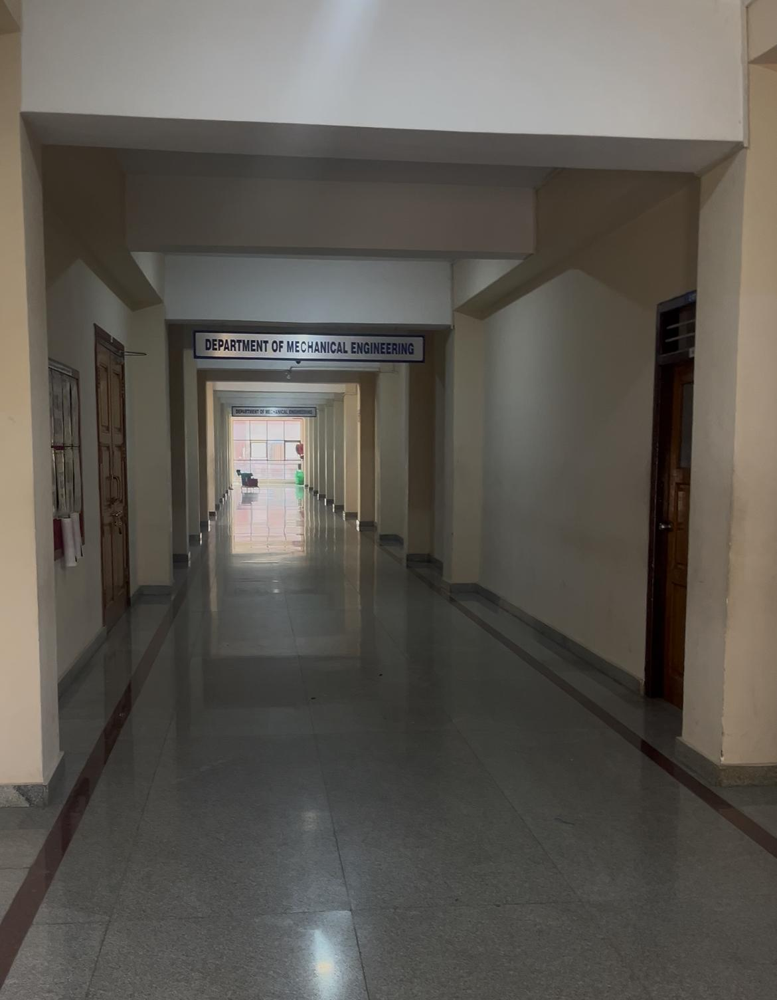
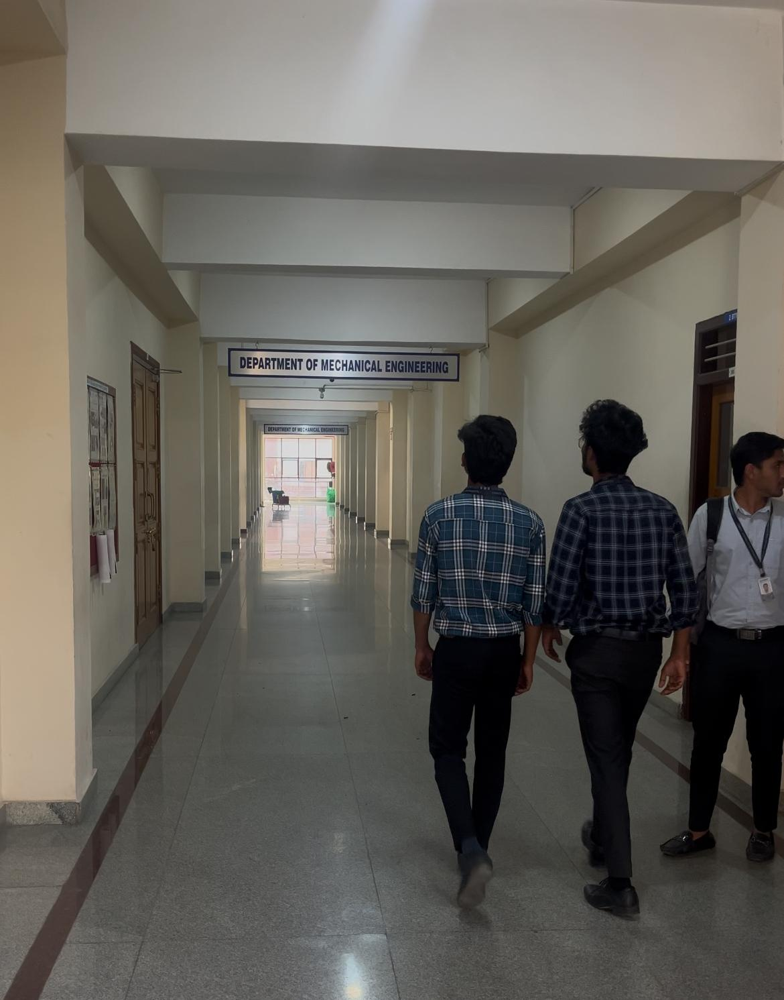

# Campus Automated Lighting System

**Motion-activated lighting across an entire campus floor, using approximately 8 PIR sensors with built-in relays to control 16 lights.**

**Thiruppathi P | Team Lead**  
**Location:** Block 3, fourth floor, CHRIST (Deemed to be University), Kengeri Campus, Bengaluru  
**Status:** Successfully installed and tested; found useful by the university.

## Overview

This service-learning project automated the lighting across a campus floor to reduce unnecessary operation of lights. PIR motion sensors switch the connected lighting on when movement is detected. After approximately 15 minutes without detected movement, the lights switch off automatically.

The installation uses PIR sensors with built-in relays and the building's existing lighting circuits. It operates through hardware switching without a microcontroller or custom software.

## My contribution

- Led the project team.
- Handled sensor integration and wiring in the campus building.
- Created the Tinkercad circuit design jointly with a teammate.

## Installation summary

| Item | Implementation |
|---|---|
| Coverage | Entire floor |
| Motion sensors | Approximately 8 PIR sensors |
| Switching | Relay built into each PIR sensor unit |
| Controlled lights | 16 |
| Switch-off delay | Approximately 15 minutes after the last detected movement |
| Power | Existing building lighting supply |
| Design tool | Tinkercad |
| Control method | Hardware-based motion switching |

## Working principle

Each PIR sensor monitors movement within its coverage area. Motion activates its built-in relay, switching the associated lighting circuit on. Further motion keeps the lighting active; after the inactivity delay, the sensor switches its relay off. Multiple sensor locations provide coverage across the floor.

The installation targets unnecessary lighting runtime. PIR sensing responds to movement, so sensor placement and the delay setting are important for maintaining useful coverage.

## Installation and operation

| Before movement | After movement |
|---|---|
|  |  |

*Corridor photographs documenting the lighting demonstration.*

*On-site work during the campus lighting installation.*

See the [installation gallery](docs/installation-gallery.md) for the remaining project photographs.

## Circuit design

The Tinkercad design illustrates motion-controlled switching using separate sensor and relay representations. The physical installation uses PIR units with built-in relays. The simulation screenshots describe the control concept; they are not an as-built mains wiring drawing.

View [schematic sheet 1](diagrams/tinkercad-schematic-1.png) and [schematic sheet 2](diagrams/tinkercad-schematic-2.png).

## Results

- Completed automated lighting coverage across the floor using approximately 8 sensors and 16 lights.
- Successfully demonstrated motion-triggered activation and automatic switch-off after approximately 15 minutes of inactivity.
- Delivered a working installation that the university found useful.

## Project files

- [Project report](reports/project-report.md)
- [Operation and maintenance overview](docs/operation.md)
- [Installation gallery](docs/installation-gallery.md)
- [Media and diagram index](docs/media-index.md)
- [GitHub description and topics](docs/repository-details.md)

No software installation or code upload is required for this hardware-based system.
